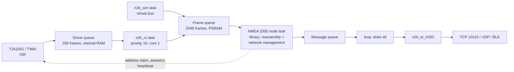

# 05 – NMEA Connectivity

## Supported Standards

The terminal is designed to accept both major marine data standards:

### NMEA 0183
- Serial protocol (typically 4800 or 38400 baud)
- Common on older instruments and many depth / wind / GPS units
- Connected via isolated RS-422 / RS-485 or opto-isolated UART
- Relatively low risk to the rest of the boat’s systems

### NMEA 2000
- CAN-bus based, modern standard
- Preferred on newer boats
- The terminal joins it as a standard NMEA 2000 node. A compliant connection needs an isolated CAN interface; until the prototype has one it runs bus-powered with a single ground (see safety section below)
- Mature open-source library ecosystem exists (`NMEA2000` + community ESP32 ports)

## What Data Should Be Displayed?

**Minimum useful set for cabin terminal:**

- Depth (below transducer / below keel)
- Boat speed (through water or SOG)
- Wind speed & direction (apparent / true if available)
- Heading or COG
- GPS position (lat/lon) — mainly for confirmation
- Battery voltage / house bank status (if available)
- Engine hours or RPM (if present on the network)

**Nice-to-have later:**
- Water temperature
- Air temperature / barometric pressure
- AIS targets (summary only)
- Autopilot status (read-only)

## Architecture Choices

### Option A – Direct NMEA to Terminal (Recommended for v1)
- Terminal talks directly to the boat’s NMEA network
- Lowest latency, works completely offline
- Simplest software path

### Option B – Signal K Bridge
- Intermediate Signal K server normalises data
- More flexible for future multi-display or richer integrations
- Adds complexity and another component to maintain

**Proposal:** Start with **Option A**. Revisit Signal K only if the pilot demonstrates clear need.

---

## NMEA 2000 Bus Safety Requirements (Critical)

Connecting any new device to a boat’s NMEA 2000 backbone is the highest-risk part of this project. The backbone often carries data used by the autopilot, chartplotter, and engine systems. A poorly designed node can degrade or disable the entire segment.

The terminal joins the backbone the way every other device does: as a standard NMEA 2000 node. Co-existence comes from following the standard, not from staying quiet. Every device on a backbone claims and defends an address, has a NAME, answers requests, sends a heartbeat, acknowledges frames, uses standard CAN fault confinement, runs the correct bit timing, and declares its LEN. The terminal does all of that, and it sends no instrument data. How it does it is in [The terminal as an NMEA 2000 node](#the-terminal-as-an-nmea-2000-node) below.

### Mandatory Requirements Before Any NMEA 2000 Connection

1. **Electrical isolation (open item on the prototype)**  
   A standard N2K device is electrically isolated from the network. The prototype is not: the Waveshare's onboard TJA1051 transceiver is not isolated, and the planned Pololu 12 V to 5 V supply is not isolated either. This cannot be fixed in firmware. The fix is an isolated CAN transceiver (TI ISO1042 / ISO1050 class, or ADI ADM3053, which also isolates power) with isolated power for the bus side, in place of the onboard TJA1051.  
   Until then the prototype goes on a backbone only bus-powered, with a single ground: all its power from NET-S / NET-C and no other wired connection. Never connect anything else that shares ground while it is on the backbone: no laptop on mains, no phone charger, no USB lead, no RS485, no second 12 V.

2. **Standard node behaviour**  
   ISO Address Claim with a proper NAME, address defence and moving to a free address on contention, answers to ISO Request, heartbeat, 250 kbit/s with the J1939 / ISO 11783 sample point, and standard CAN error handling and bus-off recovery. The terminal sends only network-management messages.

3. **Clean failure mode**  
   If the terminal loses power, locks up, or is removed, it must drop off the bus cleanly. It must never load the bus, inject noise, or hold the bus in a dominant state.

4. **Load Equivalency Number (LEN)**  
   The interface must declare and respect a realistic LEN. The terminal declares LEN 10 (at most 0.5 A from the bus) in its Product Information. The total LEN on any segment must stay within NMEA 2000 limits.

5. **Certified or high-quality drop cable**  
   Prefer a proper Micro-C drop cable and tee rather than DIY wiring. This reduces installation errors and improves reliability.

6. **Bus power only as a single-ground node**  
   A bus-powered terminal draws NET-S / NET-C through its own fuse and a DC/DC converter, stays within its declared LEN (10 LEN, 0.5 A; 20 LEN, 1 A, is the per-device maximum), and has no other wired connection while it is on the bus. Flashing and debugging happen off the bus. A self-powered terminal must not draw bus power and needs the isolated interface from item 1.

### Liability Note

Modifying a vessel’s instrument network has insurance and liability implications. Before any permanent installation on a club boat, the Board should be informed and, if appropriate, the club’s insurer consulted. This is not purely a technical decision.

### Pilot Recommendation

For the first pilot boat, prefer a vessel that already has clean NMEA 0183 outputs or a well-documented NMEA 2000 backbone with available drop points. Avoid boats where the network is poorly understood or heavily loaded until the boat-terminal connection has passed the bench test in [doc 19](19-n2k-backbone-install.md#5-bench-test-before-the-boat).

---

## Physical Connection Notes

- Installation requires identifying the existing talker (0183) or backbone (2000)
- Keep runs short
- Use proper shielding and strain relief
- Document the connection point and any LEN contribution for future maintainers

## Waveshare NMEA 2000 node (firmware)

Building the boat backbone: see [19 – NMEA 2000 Backbone Install](19-n2k-backbone-install.md).

The ESP32-S3-Touch-LCD-7 has a TJA1051 on a PH2.0 header. That transceiver is **not isolated**, and neither is the Pololu supply. A compliant device is isolated from the network, so this is an open hardware item (see [Hardware compliance](#hardware-compliance-open-items)). Until it is fixed:

- **Prototype: bus-powered, single ground.** NET-S / NET-C through a 1 A fuse and a 12 V to 5 V DC/DC into the board's USB socket. CAN-H / CAN-L to the header. Nothing else wired to the board: no USB lead, no phone charger, no laptop on mains, no RS485, no 12 V, no battery. Wi-Fi and BLE only. The declared LEN is 10. The board turns off when the bus power does.
- **Target: isolated.** An isolated CAN transceiver (TI ISO1042 / ISO1050 class, or ADI ADM3053) with isolated power for the bus side, in place of the onboard TJA1051. Never connect the bare TJA1051 to a backbone while the board has its own supply.

Wiring, DC/DC choice, LEN and bench test are in [doc 19](19-n2k-backbone-install.md#4-boat-terminal-connection). The board only accepts 5 V (USB-C); it has no wide-range DC input.

| Pin / control | Function |
|---------------|----------|
| GPIO20 | CANTX into the TJA1051. Also USB D+ when the mux is on USB. |
| GPIO19 | CANRX. Also USB D−. |
| CH422G EXIO5 | High selects CAN. Low selects USB. Default build leaves it low. |
| Jumper 13 | Onboard 120 Ω terminator. **Remove it** before any bus connection. One terminator at each physical end of the backbone is enough. |
| UART Type-C (GPIO43 / GPIO44, CH343) | Console in every mode, including `NMEA DEMO`. Also the only log once CAN owns GPIO19/20. On a bus-powered board, nothing is plugged in here. |

### Data source: simulator or NMEA 2000

The terminal runs exactly one source per boot, and says which on every screen.

| Source | What runs | Top-bar badge |
|--------|-----------|---------------|
| **Simulator** | A boat sailing a box course in English Bay on a virtual bus: GPS, compass, wind, depth and speed transducer, battery monitor, and an AIS receiver with three targets. About 40 frames/s over 15 PGN types, at the rates real devices send them. CAN stays closed and USB serial stays up. | Amber **SIMULATION** |
| **NMEA 2000** | A standard NMEA 2000 node on the CAN header. The simulator never runs, not even when the bus goes quiet. | Green **LIVE NMEA 2000** while frames arrive; red **NO DATA** or **BUS FAULT** otherwise |

The line under the top bar takes the same colour. The choice is saved on the terminal (NVS) and survives power-off and firmware updates. Change it on the glass: tap the badge, or **Diagnostics > Data source**. Choose the other source, confirm, and the terminal restarts into it. Restarting means every boot starts from a clean state: no simulated value is left on a tile after the switch, and the USB/CAN pin handover happens only at boot. Phones reconnect on their own through the remembered-boat auto-join.

`NMEA_SOURCE` in `firmware/src/secrets.h` (see `secrets.h.example`) only sets the first-boot default: `0` simulator, `1` NMEA 2000. The old `2` (AUTO, simulator until frames arrive and again whenever the bus went quiet) is gone, and `2` now means `1`. A dead sounder on a live bus must show a blank depth, not 12 m from the simulator.

Instrument tiles go blank (`—`) when their value is more than 5 s old. The converter already stops sending GNSS after 3 s, so chart apps stop getting a fix rather than a frozen one.

On the console (UART Type-C, or USB in simulator mode): `NMEA SIM`, `NMEA N2K` (save and restart), `NMEA STATS` (one line of counters), `NMEA DIAG` (hint line and diagnostics JSON), `NMEA DEMO`, or `NMEA PGN <number> [src=N] <hex>`. `NMEA AUTO` answers that it was removed. Sentences pasted on the console reach the parser only on the simulator.

`DEMO` and `PGN` run only on the simulator. They pause it and inject reassembled PGNs straight into the converter. The badge reads **SIMULATION PAUSED** and the fix tag `PLAY`. The tiles show the demo values for 5 s, then blank, because nothing repeats them. `NMEA SIM` resumes the simulator. From the Mac, with the cable in the UART Type-C socket (CH343, not the socket marked USB), `make n2k-demo` sends `NMEA DEMO`: depth 42.0 m, course 90°, speed 7.5 kn, wind 18 kn at 40° apparent, heading 45° true, plus PGN 130816. Opening the USB socket resets the chip into the ROM download bootloader.

### Receive path: nothing is dropped uncounted

The receive task runs above `loop()` on the same core and moves each frame into the frame queue as it arrives, so a slow screen redraw or photo decode does not back up the controller. 2048 frames is more than a second of a fully loaded 250 kbit/s bus. The NMEA 2000 node task drains the frame queue into the library, which reassembles fast packets and handles network management. Reassembled messages go into a message queue. `loop()` drains that on every pass and hands each message to the converter. The node runs in its own task, not in `loop()`, so address-claim and request deadlines are met whatever the screen is doing. The simulator feeds the same frame queue, so on the bench the reassembly, converter and counters run exactly as they do aboard. On the simulator CAN stays closed and nothing is transmitted anywhere. The library reads and drops every frame during the 200 ms after it opens, so the receive and simulator tasks start feeding the frame queue only once it is open: no frame is ever discarded uncounted.

Four counters cover every place data could be lost: the frame queue full, the driver queue full (including frames still in it when the controller is stopped for a restart), the controller FIFO overrun, and the message queue to `loop()` full. Their sum is **Lost frames**. The overrun count is a lower bound: the driver counts the frames it clears, not the ones that never fit. The CAN interrupt is not in IRAM, so a flash write would delay it; the terminal writes flash only when the data source is saved (just before it restarts) and when the node's address, instances or installation descriptions change, which is rare. Wi-Fi keeps its settings in RAM. Frames that are not NMEA 2000 (11-bit or remote) are counted as ignored, as are simulator frames dropped when `NMEA DEMO` pauses it. The buffer high-water mark shows how close the queue has come to full. Bus error frames and the receive error counter come from the controller. All of it is on **Data source** on the glass, in the phone's **NMEA data**, in `NMEA STATS`, on BLE `…000050`, and under `data` in `GET /status.json`.

Chart apps each get an 8 KB output queue on the terminal. A non-blocking TCP send can take part of a line, and without the queue the rest would be lost and the next sentence would start in the middle of it. Only whole lines are queued. A sentence that does not fit because an app stopped reading is counted as **not delivered**, and an app whose queue stays full for 30 s is disconnected. Failed UDP broadcasts are counted too.

### The terminal as an NMEA 2000 node

On the NMEA 2000 data source the terminal is a full NMEA 2000 node. It is built on the ttlappalainen NMEA2000 library in `N2km_ListenAndNode` mode. The same library is used in several commercially certified devices. The node is standard so that it co-exists with the other equipment the standard way: it does what every device on the backbone does, and nothing more.

**CAN.** The ESP32-S3 TWAI controller runs in normal mode at 250 kbit/s. It acknowledges frames and does standard CAN error signalling and fault confinement, like every N2K device. Bit timing uses the J1939 / ISO 11783 sample point: 87.5 %, 16 time quanta, SJW 1.

**Network management.** All of it is standard and handled by the library:

| PGN | What the terminal does |
|-----|------------------------|
| 60928 ISO Address Claim | Claims an address with its NAME and defends it. Arbitrary-address-capable: on contention it moves to a free address. |
| 59904 ISO Request | Answers requests. Sends them too, to discover the network: one global request for address claims, then one addressed request at a time (150 ms apart, three tries each) for each device's product information, configuration information and PGN list. Nothing is asked twice once answered. |
| 59392 ISO Acknowledgement | Sends ACK / NAK where the standard asks for it. |
| 126208 Group Function | Answers group functions, including commanded changes of device instance, system instance and installation descriptions. |
| 126464 PGN List | Lists the PGNs it sends and receives. |
| 126996 Product Information | See below. |
| 126998 Configuration Information | See below. |
| 126993 Heartbeat | Every 60 s. |
| 65240 Commanded Address | Moves to the address it is commanded to. |

**What it sends.** Only those network-management messages. It never sends instrument data on NMEA 2000: no position, depth, wind or anything else. Phone GNSS (`LOCAL`) never goes onto the NMEA 2000 bus.

**NAME.**

| Field | Value |
|-------|-------|
| Industry group | 4 (marine) |
| Device class | 25 (Inter/Intranetwork device) |
| Device function | 130 (PC Gateway) |
| Unique number | Low 21 bits of the board's MAC address |
| Manufacturer code | Build setting `LMYC_N2K_MANUFACTURER_CODE`, default 2046. 2046 is the open-source convention used by the library. It is **not** a code issued by NMEA. |

**Product information (126996).**

| Field | Value |
|-------|-------|
| Model ID | `LMYC boat-terminal` |
| Model version | `Waveshare ESP32-S3-Touch-LCD-7` |
| Serial code | MAC address |
| Software version | Firmware version |
| Product code | Build setting `LMYC_N2K_PRODUCT_CODE` |
| Load Equivalency (LEN) | 10 (at most 0.5 A from the bus, as budgeted in [doc 19](19-n2k-backbone-install.md#3-len--power-budget)) |
| NMEA 2000 version | 2.101 (library default) |

**Configuration information (126998).** Manufacturer information is `LMYC boat-terminal`. Installation description 1 defaults to the boat name. The installer can change both installation descriptions from any NMEA 2000 configuration tool (for example through group function), and the terminal saves them.

**What it remembers.** The claimed source address, device instance, system instance and both installation descriptions are saved in NVS flash and restored at start, as the standard requires. After a restart the terminal claims the address it had before.

**How to see it has joined.** The 740s (or any MFD) lists the terminal in its NMEA 2000 device list as **LMYC Boat Terminal**. That is the simple check a member can do.

**Bus-off.** Standard CAN bus-off recovery: the controller waits for 128 × 11 recessive bits, rejoins, and the terminal announces its address claim again.

**Timing.** The library runs in its own FreeRTOS task, not in the UI loop, so address-claim and request deadlines are met no matter what the screen is doing. Reassembled messages are handed to `loop()` for conversion to NMEA 0183.

**Clean failure.** On power loss TXD goes high-Z and the transceiver's own TXD pull-up holds the bus recessive. On a bus-powered board a blown fuse or dead DC/DC also unpowers the TJA1051, and an unpowered TJA1051 disengages from the bus with zero load (NXP datasheet). Its TXD dominant time-out releases the bus if TXD is ever stuck low.

### Diagnostics

- **Terminal, Data source screen.** The node state: "NMEA 2000 node, address N", "claiming an address", or "no free address". Under it, one hint line when something is wrong.
- **Phone, NMEA data → Bus check.** Devices on the bus, which device each value comes from, per-PGN rates, the converter counters, **Record bus → Share recording** (candump format), and **Share this bus check** (JSON).
- **HTTP.** `GET /n2k.json` and `GET /n2k/frames`.
- **Console.** `NMEA STATS` and `NMEA DIAG`.

| Hint | Meaning | Check |
|------|---------|-------|
| `repeats` | The same frame keeps repeating. Some device is not getting acknowledgements. | Wiring and termination. |
| `errors_no_frames` | Bus errors, nothing received. | CAN-H / CAN-L, both terminators, bus power. |
| `bus_off` | The terminal went bus-off after its own transmit errors and is rejoining the standard way. | CAN-H / CAN-L, both terminators. |
| `no_frames` | Nothing received. | Drop cable, 12 V on the backbone, that the other devices are on. |
| `no_address` | The terminal could not claim an address. | Device list on the MFD; capture the bus and report it. |
| `losing` | Frames are being lost before decoding. | Capture the bus and report it. |
| `fast_incomplete` | Multi-frame messages (GNSS, AIS) are not arriving whole. | Capture the bus and report it. |
| `bad_values` | A device sends error codes or impossible values. They are dropped, not shown. | Which PGN and device, in Bus check. |
| `two_sources` | Two devices send the same value. One is used; the other takes over if it stops. | Note the addresses. |

### Network topology

The terminal lists every device on the backbone the way a chart plotter builds its device list, using only what the standard says every node must answer. CAN carries no position, so this is the **logical** network, not the order of the tees: devices are shown in class order with the terminal first, and each card carries the installer's location text (installation description 1) when the device has one.

| What | From |
|------|------|
| Address, maker, class and function, device and system instance | ISO Address Claim (60928) |
| Model, software, serial, LEN, NMEA 2000 version, certification level | Product Information (126996) |
| Where it is installed | Configuration Information (126998) |
| What it sends and receives | PGN List (126464) |
| Alive, and how often it says so | Heartbeat (126993) |

Health checks, per device: **no name** (never answered for its address claim), **no product** information, **heartbeat lost** (2.5 intervals), **address changed**, **instance conflict** (same class, function and instance as another device; plotters can mix them up), **silent** (nothing for 10 s). The network total of LEN is shown against the power budget.

Tap a device (terminal **Network** screen, from the Diagnostics or Data source rail; phone **NMEA data → Network**) for its identity and health, which values the terminal takes from it, every PGN it sends with rate and the newest value decoded (or raw bytes), its recent messages, and on the phone **Record this device**: a candump capture of that device only.

On the simulator the six virtual devices are NMEA 2000 nodes too: each claims an address, sends a heartbeat and answers the terminal's requests, so the whole discovery path runs on the bench. Their frames, and the terminal's, stay on the virtual bus.

Also: `GET /n2k/network.json` (`?refresh=1` asks everyone again), `GET /n2k/device.json?src=N`, `GET /n2k/frames?after=N&src=N`, and on the console `NMEA NET`, `NMEA NET <address>`, `NMEA NET REFRESH` (`make network`, `make device SRC=N`).

### Hardware compliance (open items)

The firmware behaves as a standard node. Two things are still missing before the terminal is a fully compliant device. Neither can be fixed in firmware.

1. **Electrical isolation.** The library author's certification checklist requires the device to be electrically isolated from the network. The Waveshare's onboard TJA1051 is not isolated, and the planned Pololu 12 V to 5 V supply is not isolated. The fix is an isolated CAN transceiver (TI ISO1042 / ISO1050 class, or ADI ADM3053, which also isolates power) with isolated power for the bus side, in place of the onboard TJA1051. Until then, never connect anything else that shares ground (laptop on mains, phone charger, USB) while the terminal is on the backbone.
2. **NMEA-issued codes and certification.** The manufacturer code and product code must be issued by NMEA, which needs NMEA membership. The library author quotes about $1,200 for a manufacturer code and $450 for a product code (2024 member prices). Formal NMEA certification testing and verification cost extra; the library author's total estimate for a new member is about $4,000. Until then the terminal uses the open-source manufacturer code 2046. It behaves to the standard but it is **not certified**.

### Chart apps on a phone

The terminal sends every sentence to TCP `192.168.4.1:10110` and as UDP broadcasts to `192.168.4.255` on ports 10110 and 2000. It also sends the standard NMEA 0183 heartbeat `$IIHBT,15.0,A,<n>` (interval, status A, sequence 0–9): once to each new TCP client and then every 15 s on TCP, UDP and BLE notify `…000030` (so it shows on the app's Sentences page), so a client can tell a quiet bus from a terminal that went away. Chart apps ignore it. A laptop or tablet on the hotspot can use either directly. An Android phone with mobile data on cannot open TCP to `192.168.4.1`, because Android routes ordinary apps over mobile data while the hotspot has no internet. On a phone, chart apps are set to **UDP port 10110**, address `127.0.0.1` where the app asks for one. The LMYC app's relay holds the hotspot up and also serves TCP on `127.0.0.1:10110`. Why, and what was measured, is in [doc 06](06-phone-app-and-pairing.md#why-chart-apps-use-the-phone-itself).

The terminal's own upstream Wi-Fi (`WIFI_SSID`) is optional. Every connect attempt scans all channels and takes the radio off the hotspot channel, which stalls chart apps and BLE, so an upstream network that is not there is tried three times and then left alone until the next restart. An empty `WIFI_SSID` runs the hotspot only.

### PGN to NMEA 0183

Decoded in `firmware/src/n2k_to_0183.cpp` and pushed through the existing sentence sink, so TCP 10110 and BLE notify are unchanged. Instrument sentences are limited to about 1 Hz. AIS is forwarded as it arrives. Cached GNSS older than 3 s is dropped, not repeated, so a GPS that goes quiet stops sending a fix instead of freezing on its last one. Fields N2K reports as not available are left empty.

- **One device per value.** Position, COG/SOG, time, depth, water speed, heading, variation, each wind reference and sea temperature are each taken from one source address. Another device takes over only after the owner has sent nothing valid for 3 s. Two GPS receivers or two sounders on one backbone never alternate.
- **Error codes are rejected.** The library maps only `0xFF..` to "not available". `0xFE..` ("out of range" / "error") would otherwise decode to depth 42,949,672.9 m, wind 1274 kn, or a plausible-looking 15.5° for an angle. Angles above 2π, depth above 1000 m, boat speed above 100 kn, wind above 75 m/s and sea temperature outside −10..50 °C are dropped and counted as **bad values**. A depth offset beyond ±20 m goes out as 0.
- **SOG and COG stand alone.** A GPS at rest often sends COG "not available" with SOG 0.00. RMC and VTG then carry SOG 0.0 and an empty COG.
- **RMC time moves.** The last time PGN is advanced by the time since it arrived, with hundredths, and rolls the date at midnight. RMC/GLL/VTG mode follows the GNSS method (A, D, P, R, F, E, M, S).
- **The 1 Hz window is 900 ms**, so a 1 Hz sensor with arrival jitter is not halved.
- **Depth tile.** DPT's offset is applied on the terminal and the phone: negative is "below keel", positive "below surface", none "below transducer". The tile says which.

| PGN | Contents | 0183 |
|-----|----------|------|
| 126992 | System time | time fields on RMC / GGA |
| 129025 | Latitude / longitude | RMC / GLL cache |
| 129026 | COG / SOG | RMC / VTG cache |
| 129029 | GNSS position | RMC, GGA, GLL. GGA is only sent while 129029 is live, since its quality, satellites, and altitude come from it. "No fix" makes RMC / GLL status `V`. |
| 128267 | Depth | `$SDDPT` |
| 128259 | Water speed | `$VWVHW` |
| 130306 | Wind | `$WIMWV` for apparent (`R`) and boat-referenced true (`T`). Ground-referenced wind (true or magnetic north) is `$WIMWD`, because it is a compass direction, not an angle off the bow. |
| 127250 | Heading | `$HCHDG` if magnetic, otherwise `$HEHDT`. Variation from 127258 fills HDG when 127250 has none. |
| 127258 | Magnetic variation | RMC variation fields. Magnetic COG from 129026 becomes true COG only with a known variation; otherwise it goes out only in VTG's magnetic field, never as true. |
| 130310 / 130312 / 130316 | Sea temperature | `$YXMTW` (sea temperature source only) |
| 129038 | AIS Class A position | `!AIVDM` / `!AIVDO` type 1 |
| 129039 | AIS Class B position | type 18 |
| 129040 | AIS Class B extended position | type 19 |
| 129794 | AIS Class A static and voyage | type 5 |
| 129809 | AIS Class B static, part A | type 24 A |
| 129810 | AIS Class B static, part B | type 24 B |
| 129808 | DSC call | `$PLMYC,DSC,<hex>` (raw payload, first 16 bytes) |

DSC goes out as a proprietary `$PLMYC,DSC` sentence, not an alarm. The firmware does not synthesize `$CDDSC` or `$CDDSE`. A wrong distress sentence would look like a real distress to Navionics, and a `$CDDSE` with hex in its MMSI field would be misread by plotters. Third-party apps ignore `$P` sentences. Own-ship AIS (transceiver information "own" or a transmission) is `!AIVDO`; everything else is `!AIVDM`. Talkers are `GP`, `SD`, `WI`, `HC` / `HE`, `VW`, and `AI`.

`make firmware-test` runs host tests on the Mac (no board). One feeds library-built PGNs through the converter, checks the 0183 sentences and checksums, checks the AIS packer against published `!AIVDM` reference sentences, and decodes every AIS sentence with an independent Python decoder (`firmware/test_host/ais_check.py`). Another runs the simulator for two simulated minutes and passes its CAN frames through the library's real fast-packet reassembly: every message sent must come out, at the expected rates, as valid 0183. None of this has been run against a live NMEA 2000 bus yet. The first run is planned in [doc 21](21-first-boat-run.md).

The FIX chip reads `SIM` on the simulator, `PLAY` while it is paused for canned PGNs, `N2K` when NMEA 2000 is chosen but nothing is arriving, and `BOAT` while frames are flowing. `PHONE` still means gated GNSS inject. Tap the position icon for the source line (`NMEA 2000 - Live - 312 frames/s - 0 lost`) and the PGNs heard so far (number, name, source address, age, count), including types the converter does not turn into 0183. Instruments shows the same list from its list icon, and the crumb on that page carries the fix tag.
