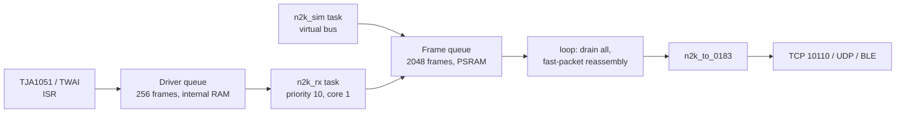

# 05 – NMEA Connectivity

## Supported Standards

The terminal is designed to accept both major marine data standards:

### NMEA 0183
- Serial protocol (typically 4800 or 38400 baud)
- Common on older instruments and many depth / wind / GPS units
- Connected via isolated RS-422 / RS-485 or opto-isolated UART
- Relatively low risk to the rest of the boat’s systems

### NMEA 2000
- CAN-bus based, modern standard
- Preferred on newer boats
- Requires a careful connection: bus-powered with a single ground, or isolated (see safety section below)
- Mature open-source library ecosystem exists (`NMEA2000` + community ESP32 ports)

## What Data Should Be Displayed?

**Minimum useful set for cabin terminal:**

- Depth (below transducer / below keel)
- Boat speed (through water or SOG)
- Wind speed & direction (apparent / true if available)
- Heading or COG
- GPS position (lat/lon) — mainly for confirmation
- Battery voltage / house bank status (if available)
- Engine hours or RPM (if present on the network)

**Nice-to-have later:**
- Water temperature
- Air temperature / barometric pressure
- AIS targets (summary only)
- Autopilot status (read-only)

## Architecture Choices

### Option A – Direct NMEA to Terminal (Recommended for v1)
- Terminal talks directly to the boat’s NMEA network
- Lowest latency, works completely offline
- Simplest software path

### Option B – Signal K Bridge
- Intermediate Signal K server normalises data
- More flexible for future multi-display or richer integrations
- Adds complexity and another component to maintain

**Proposal:** Start with **Option A**. Revisit Signal K only if the pilot demonstrates clear need.

---

## NMEA 2000 Bus Safety Requirements (Critical)

Connecting any new device to a boat’s NMEA 2000 backbone is the highest-risk part of this project. The backbone often carries data used by the autopilot, chartplotter, and engine systems. A poorly designed node can degrade or disable the entire segment.

### Mandatory Requirements Before Any NMEA 2000 Connection

1. **One ground, or isolation**  
   The terminal must never join the bus ground to a second ground. There are two accepted ways to connect:
   - **Bus-powered, single ground (primary).** The terminal takes all its power from NET-S / NET-C and has no other wired connection. Its only ground is the bus ground, so there is no ground loop and a non-isolated transceiver is acceptable. This is how bus-powered N2K sensors work.
   - **Isolated (when self-powered).** If the terminal keeps its own 12 V supply, or any other wired link (RS485, USB, 0183), the CAN interface must be galvanically isolated: an isolated CAN transceiver or a certified marine gateway.

2. **Clean failure mode**  
   If the terminal loses power, locks up, or is removed, it must drop off the bus cleanly. It must never load the bus, inject noise, or hold the bus in a dominant state.

3. **Load Equivalency Number (LEN)**  
   The interface must declare and respect a realistic LEN. The total LEN on any segment must stay within NMEA 2000 limits.

4. **Certified or high-quality drop cable**  
   Prefer a proper Micro-C drop cable and tee rather than DIY wiring. This reduces installation errors and improves reliability.

5. **Bus power only as a single-ground node**  
   A bus-powered terminal draws NET-S / NET-C through its own fuse and a DC/DC converter, declares its measured LEN (20 LEN, 1 A, maximum), and has no other wired connection while it is on the bus. Flashing and debugging happen off the bus or through an isolated USB adapter. A self-powered terminal must not draw bus power and must use the isolated method.

### Liability Note

Modifying a vessel’s instrument network has insurance and liability implications. Before any permanent installation on a club boat, the Board should be informed and, if appropriate, the club’s insurer consulted. This is not purely a technical decision.

### Pilot Recommendation

For the first pilot boat, prefer a vessel that already has clean NMEA 0183 outputs or a well-documented NMEA 2000 backbone with available drop points. Avoid boats where the network is poorly understood or heavily loaded until the boat-terminal connection has passed the bench test in [doc 19](19-n2k-backbone-install.md#5-bench-test-before-the-boat).

---

## Physical Connection Notes

- Installation requires identifying the existing talker (0183) or backbone (2000)
- Keep runs short
- Use proper shielding and strain relief
- Document the connection point and any LEN contribution for future maintainers

## Waveshare listen-only NMEA 2000 (firmware)

Building the boat backbone: see [19 – NMEA 2000 Backbone Install](19-n2k-backbone-install.md).

The ESP32-S3-Touch-LCD-7 has a TJA1051 on a PH2.0 header. That transceiver is **not isolated**, so how the board is powered decides how it may connect:

- **Primary: bus-powered.** NET-S / NET-C through a 1 A fuse and a 12 V to 5 V DC/DC into the board's USB socket. CAN-H / CAN-L to the header. Nothing else wired to the board: no USB lead, no RS485, no 12 V, no battery. Wi-Fi and BLE only. Estimated LEN is 10 until it is measured. The board turns off when the bus power does.
- **Alternative: isolated.** If the board must keep its own power or another wired link, fit an isolated CAN interface or a certified gateway between it and the tee. Never connect the bare TJA1051 to a backbone while the board has its own supply.

Wiring, DC/DC choice, LEN and bench test are in [doc 19](19-n2k-backbone-install.md#4-boat-terminal-connection). The board only accepts 5 V (USB-C); it has no wide-range DC input.

| Pin / control | Function |
|---------------|----------|
| GPIO20 | CANTX into the TJA1051. Also USB D+ when the mux is on USB. |
| GPIO19 | CANRX. Also USB D−. |
| CH422G EXIO5 | High selects CAN. Low selects USB. Default build leaves it low. |
| Jumper 13 | Onboard 120 Ω terminator. **Remove it** before any bus connection. One terminator at each physical end of the backbone is enough. |
| UART Type-C (GPIO43 / GPIO44, CH343) | Console in every mode, including `NMEA DEMO`. Also the only log once CAN owns GPIO19/20. On a bus-powered board, nothing is plugged in here. |

### Data source: simulator or NMEA 2000

The terminal runs exactly one source per boot, and says which on every screen.

| Source | What runs | Top-bar badge |
|--------|-----------|---------------|
| **Simulator** | A boat sailing a box course in English Bay on a virtual bus: GPS, compass, wind, depth and speed transducer, battery monitor, and an AIS receiver with three targets. About 40 frames/s over 15 PGN types, at the rates real devices send them. CAN stays closed and USB serial stays up. | Amber **SIMULATION** |
| **NMEA 2000** | Listen-only on the CAN header. The simulator never runs, not even when the bus goes quiet. | Green **LIVE NMEA 2000** while frames arrive; red **NO DATA** or **BUS FAULT** otherwise |

The line under the top bar takes the same colour. The choice is saved on the terminal (NVS) and survives power-off and firmware updates. Change it on the glass: tap the badge, or **Diagnostics > Data source**. Choose the other source, confirm, and the terminal restarts into it. Restarting means every boot starts from a clean state: no simulated value is left on a tile after the switch, and the USB/CAN pin handover happens only at boot. Phones reconnect on their own through the remembered-boat auto-join.

`NMEA_SOURCE` in `firmware/src/secrets.h` (see `secrets.h.example`) only sets the first-boot default: `0` simulator, `1` NMEA 2000. The old `2` (AUTO, simulator until frames arrive and again whenever the bus went quiet) is gone, and `2` now means `1`. A dead sounder on a live bus must show a blank depth, not 12 m from the simulator.

Instrument tiles go blank (`—`) when their value is more than 5 s old. The converter already stops sending GNSS after 3 s, so chart apps stop getting a fix rather than a frozen one.

On the console (UART Type-C, or USB in simulator mode): `NMEA SIM`, `NMEA N2K` (save and restart), `NMEA STATS` (one line of counters), `NMEA DEMO`, or `NMEA PGN <number> [src=N] <hex>`. `NMEA AUTO` answers that it was removed. Sentences pasted on the console reach the parser only on the simulator.

`DEMO` and `PGN` run only on the simulator. They pause it and inject reassembled PGNs straight into the converter. The badge reads **SIMULATION PAUSED** and the fix tag `PLAY`. The tiles show the demo values for 5 s, then blank, because nothing repeats them. `NMEA SIM` resumes the simulator. From the Mac, with the cable in the UART Type-C socket (CH343, not the socket marked USB), `make n2k-demo` sends `NMEA DEMO`: depth 42.0 m, course 90°, speed 7.5 kn, wind 18 kn at 40° apparent, heading 45° true, plus PGN 130816. Opening the USB socket resets the chip into the ROM download bootloader.

### Receive path: nothing is dropped uncounted

The receive task runs above `loop()` on the same core and moves each frame into the frame queue as it arrives, so a slow screen redraw or photo decode does not back up the controller. 2048 frames is more than a second of a fully loaded 250 kbit/s bus. `loop()` drains the whole queue on every pass. The simulator feeds the same frame queue, so on the bench the reassembly, converter and counters run exactly as they do aboard. The library's 200 ms settling time after opening is over before either producer starts, so it never throws a frame away.

Three counters cover every place a frame could be lost: the frame queue full, the driver queue full (including frames still in it when the controller is stopped after a bus fault), and the controller FIFO overrun. Their sum is **Lost frames**. The overrun count is a lower bound: the driver counts the frames it clears, not the ones that never fit. The CAN interrupt is not in IRAM, so a flash write would delay it; the terminal writes flash only when the data source is saved, just before it restarts, and Wi-Fi keeps its settings in RAM. Frames that are not NMEA 2000 (11-bit or remote) are counted as ignored, as are simulator frames dropped when `NMEA DEMO` pauses it. The buffer high-water mark shows how close the queue has come to full. Bus error frames and the receive error counter come from the controller. All of it is on **Data source** on the glass, in the phone's **Boat data**, in `NMEA STATS`, on BLE `…000050`, and under `data` in `GET /status.json`.

Chart apps each get an 8 KB output queue on the terminal. A non-blocking TCP send can take part of a line, and without the queue the rest would be lost and the next sentence would start in the middle of it. Only whole lines are queued. A sentence that does not fit because an app stopped reading is counted as **not delivered**, and an app whose queue stays full for 30 s is disconnected. Failed UDP broadcasts are counted too.

The node does not transmit. The TWAI controller is installed in listen-only mode, and the library mode is `N2km_ListenOnly`. Preferred source address 22 is stored for the library and is **not** sent as an ISO Address Claim. `CANSendFrame` does not call `twai_transmit`. On bus-off the driver is uninstalled, GPIO20 is an input with pull-up (TJA1051 TXD high is recessive), and a later retry is still listen-only. Power loss leaves TXD high-Z; the transceiver's own TXD pull-up holds the bus recessive. On a bus-powered board a blown fuse or dead DC/DC also unpowers the TJA1051, and an unpowered TJA1051 disengages from the bus with zero load (NXP datasheet). Its TXD dominant time-out also releases the bus if TXD is ever stuck low.

### Chart apps on a phone

The terminal sends every sentence to TCP `192.168.4.1:10110` and as UDP broadcasts to `192.168.4.255` on ports 10110 and 2000. A laptop or tablet on the hotspot can use either directly. An Android phone with mobile data on cannot open TCP to `192.168.4.1`, because Android routes ordinary apps over mobile data while the hotspot has no internet. On a phone, chart apps are set to **UDP port 10110**, address `127.0.0.1` where the app asks for one. The LMYC app's relay holds the hotspot up and also serves TCP on `127.0.0.1:10110`. Why, and what was measured, is in [doc 06](06-phone-app-and-pairing.md#why-chart-apps-use-the-phone-itself).

The terminal's own upstream Wi-Fi (`WIFI_SSID`) is optional. Every connect attempt scans all channels and takes the radio off the hotspot channel, which stalls chart apps and BLE, so an upstream network that is not there is tried three times and then left alone until the next restart. An empty `WIFI_SSID` runs the hotspot only.

### PGN to NMEA 0183

Decoded in `firmware/src/n2k_to_0183.cpp` and pushed through the existing sentence sink, so TCP 10110 and BLE notify are unchanged. Instrument sentences are limited to about 1 Hz. AIS is forwarded as it arrives. Cached GNSS older than 3 s is dropped, not repeated, so a GPS that goes quiet stops sending a fix instead of freezing on its last one. Fields N2K reports as not available are left empty.

| PGN | Contents | 0183 |
|-----|----------|------|
| 126992 | System time | time fields on RMC / GGA |
| 129025 | Latitude / longitude | RMC / GLL cache |
| 129026 | COG / SOG | RMC / VTG cache |
| 129029 | GNSS position | RMC, GGA, GLL. GGA is only sent while 129029 is live, since its quality, satellites, and altitude come from it. "No fix" makes RMC / GLL status `V`. |
| 128267 | Depth | `$SDDPT` |
| 128259 | Water speed | `$VWVHW` |
| 130306 | Wind | `$WIMWV` for apparent (`R`) and boat-referenced true (`T`). Ground-referenced wind (true or magnetic north) is `$WIMWD`, because it is a compass direction, not an angle off the bow. |
| 127250 | Heading | `$HCHDG` if magnetic, otherwise `$HEHDT` |
| 129038 | AIS Class A position | `!AIVDM` / `!AIVDO` type 1 |
| 129039 | AIS Class B position | type 18 |
| 129040 | AIS Class B extended position | type 19 |
| 129794 | AIS Class A static and voyage | type 5 |
| 129809 | AIS Class B static, part A | type 24 A |
| 129810 | AIS Class B static, part B | type 24 B |
| 129808 | DSC call | `$PLMYC,DSC,<hex>` (raw payload, first 16 bytes) |

DSC goes out as a proprietary `$PLMYC,DSC` sentence, not an alarm. The firmware does not synthesize `$CDDSC` or `$CDDSE`. A wrong distress sentence would look like a real distress to Navionics, and a `$CDDSE` with hex in its MMSI field would be misread by plotters. Third-party apps ignore `$P` sentences. Own-ship AIS (transceiver information "own" or a transmission) is `!AIVDO`; everything else is `!AIVDM`. Talkers are `GP`, `SD`, `WI`, `HC` / `HE`, `VW`, and `AI`.

`make firmware-test` runs host tests on the Mac (no board). One feeds library-built PGNs through the converter, checks the 0183 sentences and checksums, checks the AIS packer against published `!AIVDM` reference sentences, and decodes every AIS sentence with an independent Python decoder (`firmware/test_host/ais_check.py`). Another runs the simulator for two simulated minutes and passes its CAN frames through the library's real fast-packet reassembly: every message sent must come out, at the expected rates, as valid 0183. None of this has been run against a live NMEA 2000 bus.

The FIX chip reads `SIM` on the simulator, `PLAY` while it is paused for canned PGNs, `N2K` when NMEA 2000 is chosen but nothing is arriving, and `BOAT` while frames are flowing. `PHONE` still means gated GNSS inject. Tap the position icon for the source line (`NMEA 2000 - Live - 312 frames/s - 0 lost`) and the PGNs heard so far (number, name, source address, age, count), including types the converter does not turn into 0183. Instruments shows the same list from its list icon, and the crumb on that page carries the fix tag.
