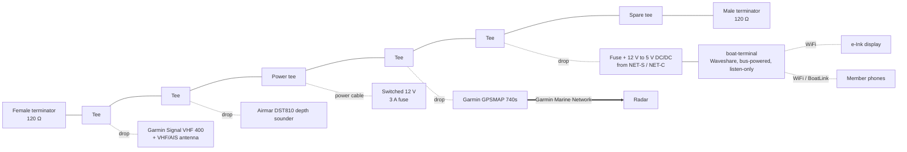
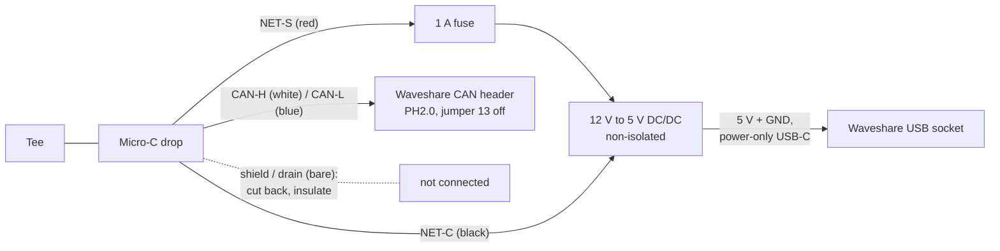

# 19 – NMEA 2000 Backbone Install

The club has approved an NMEA 2000 (N2K) backbone on the boat. This doc is the build plan: layout, parts, power, the boat-terminal drop, a bench test, and commissioning.

Firmware details live elsewhere. See [05 – NMEA Connectivity](05-nmea-connectivity.md) for bus safety and the PGN table, and [firmware/README.md](../firmware/README.md) for build and flash.

**Status:** draft. Nothing here has been installed or tested on a live bus yet.

## 1. Topology

N2K is one straight line. Tees sit end to end along the backbone. Each device hangs off the top of a tee on a drop cable. A 120 Ω terminator closes each physical end. Power comes in through one fused tap.

Only the solid line between the terminators is the N2K bus. The radar, e-Ink display and phones are not on it.

Rules:

| Rule | Value |
|------|-------|
| Terminators | Exactly two, one male and one female, at the physical ends. None in devices. |
| Drop cable | 6 m max each. |
| Total drop length | 78 m max (Micro/Light cable). |
| Backbone length, Micro/Light cable | 100 m max. |
| Backbone length, Mid cable | 100 m max. Mid only helps with power, not length. |
| Backbone length, Heavy cable | 200 m max. Not needed on this boat. |
| Power tap | One. Near the middle of the load. Switched, not straight to the battery. |
| Backbone cables | Side to side between tees only. Never into the top of a tee. |

Order the tees to match where things are mounted. The order in the diagram is a placeholder.

The spare tee lets the club add a wind sensor later without opening the backbone.

The drop, backbone and Garmin rules come from Garmin's NMEA 2000 technical reference ([glossary](https://www8.garmin.com/manuals/webhelp/GUID-1415AAD0-FE63-42A6-8F8D-DB713D616122/EN-US/GUID-9C47C97C-88A2-4EC6-9846-9B6937C3ACA7.html)). The 78 m total drop and the Heavy cable figures are the usual NMEA 2000 limits. They are not yet confirmed from a primary source, so check them against the Garmin reference before buying long runs.

## 2. Parts list

| Qty | Part | Part number | Notes |
|-----|------|-------------|-------|
| 1 | Garmin NMEA 2000 Starter Kit | 010-11442-00 | Two tees, male and female terminators, 2 m drop, 6 m backbone, 2 m power cable. [Garmin](https://garminssa.com/ghana/010-11442-00-nmea-2000-starter-kit.html), [The GPS Store](https://www.thegpsstore.com/Marine-Electronics/NMEA-2000-Components/Garmin-NMEA-2000-Starter-Kit). One reseller lists a 10 m backbone; most say 6 m. |
| 3–4 | Extra Micro-C tees | TBD | Total needed is five (four devices plus power), plus one spare. The kit gives two. |
| As measured | Micro-C backbone cable | TBD | Length from the mounting plan. |
| 0–2 | Micro-C drop cables | TBD | The VHF and 740s may come with one. Check what's on the boat. |
| 1 | Micro-C drop, bare wire one end, or field-attach connector | TBD | For boat-terminal. All five wires are used: power, data, and the drain is cut back. |
| 1 | 12 V to 5 V DC/DC buck, 9–16 V in or wider, 5 V at 2 A or more, non-isolated | Pololu D36V28F5 (first choice) or Mean Well DDR-15G-5 | See section 4.1. |
| 1 | Inline fuse holder and 1 A fuse | — | On NET-S in the boat-terminal drop, before the DC/DC. |
| 1 | Short USB-C power-only lead (VBUS and GND only) | — | DC/DC output into the board's **USB** socket. No data wires. |
| 1 | Inline fuse holder and 3 A fuse | — | For the power tap. Usually on the kit power cable. Confirm. |

Part numbers marked TBD were not verified in this pass. No prices are listed; the ones seen online ranged widely by reseller.

No isolated CAN interface is needed for the primary connection. See section 4.2 if one is ever needed.

## 3. LEN / power budget

LEN is the load each device puts on bus power. 1 LEN = 50 mA. A device may draw at most 20 LEN (1 A) from the bus ([NMEA](https://web.nmea.org/External/WCPages/WCWebContent/webcontentpage.aspx?ContentID=391)).

| Device | LEN | Source |
|--------|-----|--------|
| Garmin Signal VHF 400 | 1 (50 mA) | [Install specs](https://www8.garmin.com/manuals/webhelp/GUID-60E76EAD-A560-449E-A528-6C89D9026DB3/EN-US/GUID-FD8D10A4-78DB-4E5F-A87F-59A95E979777.html) |
| Garmin GPSMAP 740s | 2 (100 mA max) | [700 series install specs](https://www.manualsdir.com/manuals/107866/garmin-gpsmap-190-01155-02-gpsmap-700-series-gpsmap-740s.html?page=8) |
| Airmar DST810 thru-hull (chosen) | 3 | [Airmar DST810](https://www.airmar.com/Catalog/Marine/NMEA-SMART-Sensors/DST810-LSP) |
| boat-terminal (bus-powered) | **10 (500 mA)** | Estimate. See below. Replace with the bench measurement. |
| **Total** | **16 (800 mA)** | |

The VHF and the 740s also have their own main power. Their LEN is only the N2K interface.

Sixteen LEN on a 3 A tap is inside the limits. boat-terminal's 10 LEN is under the 20 LEN per-device maximum. With Micro/Light cable the usual planning limit is about 3 A per side of the power tap, so a centred tap still leaves room. boat-terminal is the biggest load, so put its tee close to the power tee.

### How boat-terminal's 10 LEN was worked out

Waveshare publishes one figure for the ESP32-S3-Touch-LCD-7: **5 V, 450 mA**, with input "Type-C 5 V" ([wiki](https://www.waveshare.com/wiki/ESP32-S3-Touch-LCD-7), [docs](https://docs.waveshare.com/ESP32-S3-Touch-LCD-7)). It doesn't say whether that is with the backlight full or Wi-Fi sending, so the rest is an estimate.

- The backlight driver is an AP3032 boost from 5 V ([schematic](https://files.waveshare.com/wiki/ESP32-S3-Touch-LCD-7/ESP32-S3-Touch-LCD-7-Sch.pdf), V1.2). Its 1.8 Ω sense resistor and 200 mV reference ([AP3032 datasheet](https://www.diodes.com/assets/Datasheets/AP3032.pdf)) set about 110 mA of LED current at full brightness.
- Wi-Fi transmit peaks at 340 mA on the ESP32-S3, against about 90 mA when receiving ([ESP32-S3 datasheet](https://documentation.espressif.com/esp32-s3_datasheet_en.pdf), table 4-7). The 3.3 V rail comes from a linear regulator, so that peak shows up as about 250 mA extra at 5 V.
- Design figure (estimate): 450 + 250 = **700 mA at 5 V, 3.5 W**.

At the bus, through a DC/DC at 85 % efficiency:

| Case | Power in | At 12 V | At 9 V |
|------|----------|---------|--------|
| Waveshare figure, 450 mA at 5 V | 2.6 W | 220 mA | 295 mA |
| Design peak, 700 mA at 5 V (estimate) | 4.1 W | 345 mA | 460 mA |

LEN uses the worst case: 460 mA at 9 V, rounded up to 10 LEN. Measure on the bench (section 5) and update this table before commissioning.

The board also has a CS8501 lithium charger on its PH2.0 battery header, set to 580 mA. **Leave the battery header empty.** A battery would add up to 580 mA of charging load on the bus.

Airmar says the DST810 is being replaced by the DST820 by mid-2026. If the club buys new, check the DST820 sheet.

## 4. boat-terminal connection

### 4.1 Primary: powered from the bus

boat-terminal takes its power and its data from one drop cable. Its only ground is the bus ground, NET-C. With one ground there is no ground loop, so the onboard TJA1051 does not need isolation. Small bus-powered N2K sensors work the same way.

The board only accepts 5 V, on its USB-C sockets. There is no wide-range DC input on this board. So a DC/DC converter turns bus power into 5 V.

Wiring:

1. Remove jumper 13, the onboard 120 Ω terminator.
2. NET-S (red) through a 1 A fuse to the DC/DC input +.
3. NET-C (black) to the DC/DC input −.
4. DC/DC 5 V output to the board through a power-only USB-C lead into the socket marked **USB**. That socket's VBUS goes straight onto the board's 5 V rail. Leave the UART socket empty.
5. CAN-H (white) and CAN-L (blue) to the board's CAN header (PH2.0, High and Low). Check colours against the cable's own sheet.
6. Shield / drain (bare): cut it back at the boat-terminal end and insulate it. On N2K the shield is grounded at one point only, the power tap. Devices don't connect it.
7. Set `NMEA_SOURCE` to `1` (or `2` for AUTO) in `firmware/src/secrets.h`. See [05](05-nmea-connectivity.md#waveshare-listen-only-nmea-2000-firmware).

The DC/DC must have a common ground between input and output, like the Pololu. The CAN header has no ground pin. The TJA1051 gets its bus reference through the board ground, so board ground must be NET-C. If an isolated converter like the Mean Well is used, link its output − to input −.

DC/DC picks:

| Module | Input | Output | Notes |
|--------|-------|--------|-------|
| [Pololu D36V28F5](https://www.pololu.com/product/3782) | 5.3–50 V | 5 V, 3.2 A | First choice. Non-isolated, so the grounds are already common. Reverse-voltage protection to 40 V, soft-start, 80–90 % efficient. Bare board: needs an enclosure and conformal coat for the boat. |
| [Mean Well DDR-15G-5](https://www.meanwell-web.com/en/mean-well-ddr-15g-5-ddr-15g-5) | 9–36 V | 5 V, 3 A (2.7 A at 9–12 V) | Enclosed, DIN rail, −40 to +85 °C ([spec](https://meanwell.si/upload/prod_spec/DDR-15-spec.pdf)). Isolated, so link −Vo to −Vin. Its undervoltage lockout turns on at 9 V and off at 8.5 V, so it may drop out on a sagging bus. |

**The hard rule: no other wired connection while it's on the bus.**

- No USB lead to a laptop on mains or ship power.
- No RS485 or NMEA 0183 wire.
- No separate 12 V feed.
- No battery on the PH2.0 header.
- Wi-Fi and BLE only.

Any second wire brings back a second ground, and with it the ground loop. Flash and debug the board off the bus, or through an isolated USB adapter, or from a laptop running on its own battery with nothing else plugged in.

boat-terminal turns off whenever the N2K power is switched off. That's expected. The helm display and the phone link come back when the bus does.

If the fuse blows or the DC/DC fails, the TJA1051 has no power. It then disengages from the bus with zero load ([TJA1051 datasheet](https://www.nxp.com/docs/en/data-sheet/TJA1051.pdf)), and the firmware never transmits anyway.

### 4.2 Alternative: isolated connection

Use one of these only if boat-terminal must keep its own power, or needs another wired link while it's on the bus (for example an RS485 0183 instrument, or a permanent USB lead). In those cases the board has two grounds, so the bus side must be isolated.

- **Isolated CAN module on spare pins.** An [M5Stack Unit CAN](https://docs.m5stack.com/en/unit/Unit_CAN) or a [MikroE CAN Isolator Click](https://www.mikroe.com/can-isolator-click) wired to GPIO43/44 on the UART header, with the onboard TJA1051 left disconnected. It's a pin change in `n2k.cpp` and avoids the USB/CAN pin swap. It takes over the UART log pins. It is an uncertified, home-made node, so it must pass the bench test below. Its bus side must not be terminated. If it draws from NET-S, count its LEN.
- **Actisense NGW-1 gateway into RS485.** The [NGW-1](https://actisense.com/products/nmea-2000-gateway-ngw-1/) is a certified, isolated N2K to 0183 gateway. Its 0183 output goes into the board's RS485 header. Nothing home-made touches the bus. It needs new firmware to read 0183 from RS485, and the N2K code becomes a fallback.

Waveshare's isolated CAN HATs ([2-CH CAN HAT](https://www.waveshare.com/2-ch-can-hat.htm)) are SPI controllers with their own MCP2515. They don't fit the ESP32's built-in CAN controller and are **not** a recommendation here.

## 5. Bench test before the boat

Do this on a table, not on the boat.

Bus:

- Two terminators, one power tee with a fused bench 12 V supply (adjustable, so it can go down to 9 V), two or three tees.
- One known N2K talker (the 740s, the VHF, or a spare GPS) **or** a USB-CAN adapter running a simulator.
- A sniffer (USB-CAN adapter with candump or a similar tool) to watch the bus.
- A multimeter or USB-C power meter for current.

Flash and check the log with the board **off** the bus, on USB from the laptop. Unplug the laptop from the board before the drop goes on. The sniffer can stay on the laptop. Never have the laptop plugged into the board and the drop on at the same time.

Checks:

| # | Check | Pass |
|---|-------|------|
| 1 | `make firmware-test` on a Mac | All checks pass. |
| 2 | `make firmware` builds | No errors. |
| 3 | Off the bus: flash with `NMEA_SOURCE 1`. Watch the UART Type-C log. | CAN comes up. EXIO5 goes high. USB CDC drops as expected. |
| 4 | Unplug the laptop. Power the board from the drop through the fuse and DC/DC. | Board boots. Screen and Wi-Fi come up. Nothing else is wired to it. |
| 5 | Current at 12 V into the drop, backlight full, Wi-Fi active (phone streaming TCP 10110) | Note the peak. Update the LEN in section 3. Must stay under 1 A (20 LEN). |
| 6 | Turn the bench supply down to 9 V | Board keeps running, no resets. Note the current at 9 V. |
| 7 | Pin handover on GPIO19/20 | Frames count up on the FIX chip or phone. This has never been tested on hardware. |
| 8 | Sniffer filtered on boat-terminal | **Zero** frames from it. No address claim. No error frames when it joins or leaves. |
| 9 | Pull boat-terminal's drop while the bus runs | Other traffic carries on with no errors. |
| 10 | Pull the fuse while the bus runs | Same. The unpowered TJA1051 loads nothing. |
| 11 | Phone on BoatLink, TCP 10110 | RMC, DPT and AIVDM sentences arrive. |
| 12 | FIX chip | Shows BOAT while frames flow. |

Test `NMEA SIM` and back to `NMEA N2K` off the bus, on USB, where the console is reachable.

## 6. Commissioning on the boat

| # | Check | Pass |
|---|-------|------|
| 1 | Bus power off. Ohms between CAN-H and CAN-L at any tee. | About 60 Ω. 120 Ω means a terminator is missing. 40 Ω means one too many. |
| 2 | boat-terminal: nothing wired but the drop | No USB, RS485, 12 V or battery lead on the board. Jumper 13 off. |
| 3 | Bus power on, everything running, boat-terminal backlight full. Volts NET-S to NET-C at the far end from the tap. | At least 9 V under load, ideally close to battery. |
| 4 | Same reading at boat-terminal's drop | At least 9 V. |
| 5 | 740s device list | VHF 400, depth sounder listed. boat-terminal will **not** appear, because it never claims an address. |
| 6 | Depth on the 740s | Reads and matches a known depth. |
| 7 | VHF GPS and AIS on the 740s | Position and AIS targets show. |
| 8 | boat-terminal FIX chip | Shows BOAT. |
| 9 | Phone over BoatLink | Depth, position and AIS targets show. |
| 10 | Switch bus power off and on | boat-terminal goes dark and comes back by itself. Everything else comes back without a reboot. |

Write the as-built order of tees, cable lengths, the measured boat-terminal current and the LEN total into the boat's maintenance book.

## 7. Open questions

- **boat-terminal current.** The 10 LEN is an estimate. Measure it on the bench (section 5, checks 5 and 6).
- **DC/DC enclosure.** The Pololu is a bare board. It needs a dry, ventilated box near the display.
- **Mounting positions and cable lengths.** Needed before ordering backbone cable and extra tees.
