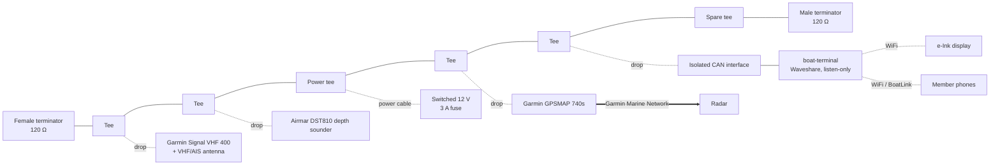

# 19 – NMEA 2000 Backbone Install

The club has approved an NMEA 2000 (N2K) backbone on the boat. This doc is the build plan: layout, parts, power, the boat-terminal drop, a bench test, and commissioning.

Firmware details live elsewhere. See [05 – NMEA Connectivity](05-nmea-connectivity.md) for bus safety and the PGN table, and [firmware/README.md](../firmware/README.md) for build and flash.

**Status:** draft. Nothing here has been installed or tested on a live bus yet.

## 1. Topology

N2K is one straight line. Tees sit end to end along the backbone. Each device hangs off the top of a tee on a drop cable. A 120 Ω terminator closes each physical end. Power comes in through one fused tap.

Only the solid line between the terminators is the N2K bus. The radar, e-Ink display and phones are not on it.

Rules:

| Rule | Value |
|------|-------|
| Terminators | Exactly two, one male and one female, at the physical ends. None in devices. |
| Drop cable | 6 m max each. |
| Total drop length | 78 m max (Micro/Light cable). |
| Backbone length, Micro/Light cable | 100 m max. |
| Backbone length, Mid cable | 100 m max. Mid only helps with power, not length. |
| Backbone length, Heavy cable | 200 m max. Not needed on this boat. |
| Power tap | One. Near the middle of the load. Switched, not straight to the battery. |
| Backbone cables | Side to side between tees only. Never into the top of a tee. |

Order the tees to match where things are mounted. The order in the diagram is a placeholder.

The spare tee lets the club add a wind sensor later without opening the backbone.

The drop, backbone and Garmin rules come from Garmin's NMEA 2000 technical reference ([glossary](https://www8.garmin.com/manuals/webhelp/GUID-1415AAD0-FE63-42A6-8F8D-DB713D616122/EN-US/GUID-9C47C97C-88A2-4EC6-9846-9B6937C3ACA7.html)). The 78 m total drop and the Heavy cable figures are the usual NMEA 2000 limits. They are not yet confirmed from a primary source, so check them against the Garmin reference before buying long runs.

## 2. Parts list

| Qty | Part | Part number | Notes |
|-----|------|-------------|-------|
| 1 | Garmin NMEA 2000 Starter Kit | 010-11442-00 | Two tees, male and female terminators, 2 m drop, 6 m backbone, 2 m power cable. [Garmin](https://garminssa.com/ghana/010-11442-00-nmea-2000-starter-kit.html), [The GPS Store](https://www.thegpsstore.com/Marine-Electronics/NMEA-2000-Components/Garmin-NMEA-2000-Starter-Kit). One reseller lists a 10 m backbone; most say 6 m. |
| 3–4 | Extra Micro-C tees | TBD | Total needed is five (four devices plus power), plus one spare. The kit gives two. |
| As measured | Micro-C backbone cable | TBD | Length from the mounting plan. |
| 0–2 | Micro-C drop cables | TBD | The VHF and 740s may come with one. Check what's on the boat. |
| 1 | Micro-C drop, bare wire one end, or field-attach connector | TBD | For the boat-terminal isolated interface. |
| 1 | Isolated CAN interface | **Not chosen** | See section 4 and open questions. |
| 1 | Inline fuse holder and 3 A fuse | — | Usually on the kit power cable. Confirm. |

Part numbers marked TBD were not verified in this pass. No prices are listed; the ones seen online ranged widely by reseller.

## 3. LEN / power budget

LEN is the load each device puts on bus power. 1 LEN = 50 mA. A device may draw at most 20 LEN (1 A) from the bus ([NMEA](https://web.nmea.org/External/WCPages/WCWebContent/webcontentpage.aspx?ContentID=391)).

| Device | LEN | Source |
|--------|-----|--------|
| Garmin Signal VHF 400 | 1 (50 mA) | [Install specs](https://www8.garmin.com/manuals/webhelp/GUID-60E76EAD-A560-449E-A528-6C89D9026DB3/EN-US/GUID-FD8D10A4-78DB-4E5F-A87F-59A95E979777.html) |
| Garmin GPSMAP 740s | 2 (100 mA max) | [700 series install specs](https://www.manualsdir.com/manuals/107866/garmin-gpsmap-190-01155-02-gpsmap-700-series-gpsmap-740s.html?page=8) |
| Airmar DST810 thru-hull (chosen) | 3 | [Airmar DST810](https://www.airmar.com/Catalog/Marine/NMEA-SMART-Sensors/DST810-LSP) |
| boat-terminal | 0 | Own 12 V supply. Never NET-S/NET-C. |
| **Total** | **6 (300 mA)** | |

The VHF and the 740s also have their own main power. Their LEN is only the N2K interface.

Six LEN on a 3 A tap is far inside any limit. With Micro/Light cable the usual planning limit is about 3 A per side of the power tap, so a centred tap leaves lots of room.

Airmar says the DST810 is being replaced by the DST820 by mid-2026. If the club buys new, check the DST820 sheet.

## 4. boat-terminal connection

The Waveshare's onboard TJA1051 is **not isolated**. It must not go straight onto the backbone. Put an isolated CAN interface between the board's CAN header and the drop.

1. Remove jumper 13, the onboard 120 Ω terminator.
2. Wire the board's CAN-H and CAN-L (PH2.0 header) to the board side of the isolator.
3. Wire the bus side of the isolator to the drop: CAN-H (white), CAN-L (blue), shield (bare). Check colours against the cable's own sheet.
4. Leave NET-S (red) and NET-C (black) unconnected. Tape them back.
5. Power the board from the boat's switched 12 V through its own fuse and a 12 V-to-5 V supply. Not from the bus.
6. Set `NMEA_SOURCE` to `1` (or `2` for AUTO) in `firmware/src/secrets.h`. See [05](05-nmea-connectivity.md#waveshare-listen-only-nmea-2000-firmware).

Choosing the isolator is still open. What it needs:

- CAN-to-CAN isolation (an isolated repeater), because the TJA1051 is already on the board. A bare isolated transceiver chip would mean bypassing the onboard one.
- Its bus side powered from the isolator's own isolated supply, or from NET-S at a tiny draw. If it draws from NET-S, count its LEN.
- No terminator on it, or one that can be switched off.
- 250 kbit/s.

Waveshare's isolated CAN HATs ([2-CH CAN HAT](https://www.waveshare.com/2-ch-can-hat.htm)) are SPI controllers with their own MCP2515. They don't fit the ESP32's built-in CAN controller and are **not** a recommendation here.

## 5. Bench test before the boat

Do this on a table, not on the boat.

Bus:

- Two terminators, one power tee with a fused bench 12 V supply, two or three tees.
- One known N2K talker (the 740s, the VHF, or a spare GPS) **or** a USB-CAN adapter running a simulator.
- A sniffer (USB-CAN adapter with candump or a similar tool) to watch the bus.

Checks:

| # | Check | Pass |
|---|-------|------|
| 1 | `make firmware-test` on a Mac | All checks pass. |
| 2 | `make firmware` builds | No errors. |
| 3 | Flash with `NMEA_SOURCE 1`. Watch the UART Type-C log. | CAN comes up. EXIO5 goes high. USB CDC drops as expected. |
| 4 | Pin handover on GPIO19/20 | Log shows frames counting up. This has never been tested on hardware. |
| 5 | `NMEA SIM` on the console, then back to `NMEA N2K` | Switches both ways. If USB doesn't return, a reboot does. |
| 6 | Sniffer filtered on boat-terminal's address | **Zero** frames from it. No address claim. No error frames when it joins or leaves. |
| 7 | Pull boat-terminal's power while the bus runs | Other traffic carries on with no errors. |
| 8 | Phone on BoatLink, TCP 10110 | RMC, DPT and AIVDM sentences arrive. |
| 9 | FIX chip | Shows N2K. |

## 6. Commissioning on the boat

| # | Check | Pass |
|---|-------|------|
| 1 | Bus power off. Ohms between CAN-H and CAN-L at any tee. | About 60 Ω. 120 Ω means a terminator is missing. 40 Ω means one too many. |
| 2 | Bus power on. Volts NET-S to NET-C at the far end from the tap. | At least 9 V, ideally close to battery. |
| 3 | 740s device list | VHF 400, depth sounder listed. boat-terminal will **not** appear, because it never claims an address. |
| 4 | Depth on the 740s | Reads and matches a known depth. |
| 5 | VHF GPS and AIS on the 740s | Position and AIS targets show. |
| 6 | boat-terminal FIX chip | Shows BOAT. |
| 7 | Phone over BoatLink | Depth, position and AIS targets show. |
| 8 | Switch bus power off and on | Everything comes back without a reboot. |

Write the as-built order of tees, cable lengths and LEN total into the boat's maintenance book.

## 7. Open questions

- **Isolated interface.** No part chosen yet. See section 4.
- **Mounting positions and cable lengths.** Needed before ordering backbone cable and extra tees.
