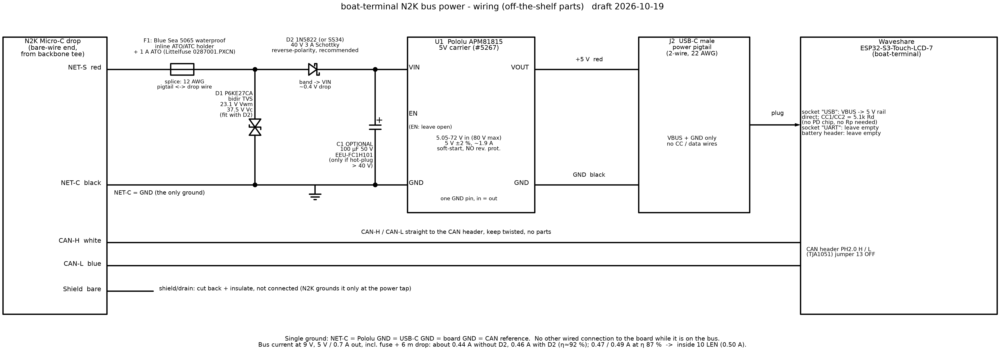

# 20 – N2K Bus Power Supply

This is how boat-terminal takes its power from the NMEA 2000 drop. It uses only bought parts. There is no custom PCB.

It is the detail behind [19 – NMEA 2000 Backbone Install](19-n2k-backbone-install.md), section 4.1.

**Status:** draft, 2026-10-18; converter changed to the Pololu APM81815 on 2026-10-19. Nothing here has been built or tested yet.

Files:

| File | What it is |
|------|------------|
| [schematic.png](assets/n2k-power/schematic.png) | Wiring diagram |
| [schematic.svg](assets/n2k-power/schematic.svg) | Same diagram, scalable |
| [schematic.py](assets/n2k-power/schematic.py) | schemdraw script that draws both. Run `python3 schematic.py`. |
| [bom.csv](assets/n2k-power/bom.csv) | Parts list with part numbers, specs and links |

## What it does

It powers the Waveshare ESP32-S3-Touch-LCD-7 from the N2K drop (NET-S / NET-C) with no custom PCB:

`NET-S → inline 1 A ATO fuse → [D1 TVS to NET-C] → [D2 Schottky] → Pololu APM81815 VIN` · `NET-C → Pololu GND` · `Pololu 5 V / GND → USB-C power pigtail → Waveshare "USB" socket` · `CAN-H / CAN-L → CAN header` · shield cut back.

Recommended: fit D2 (a 1N5822 Schottky in series, for reverse-polarity protection) and D1 (a P6KE27CA TVS on the bus side of D2). Both are axial parts, about $1 each, soldered into the wiring. Optional: a 100 µF electrolytic (C1) across the Pololu VIN/GND pins, only if the hot-plug test needs it.

## Is the Pololu APM81815 suitable? Yes.

U1 is the [Pololu APM81815 Step-Down Voltage Regulator Carrier, 5V Out](https://www.pololu.com/product/5267) (#5267), US$6.95 (one off, checked 2026-10-19). Figures are from that page and its graphs, and from the Allegro [APM81815 datasheet](https://www.pololu.com/file/0J2232/APM81815-Datasheet.pdf) it links to, unless noted.

| Need | Pololu APM81815 (#5267) | Verdict |
|---|---|---|
| 9–16 V bus, ~8 V cranking dips | 5.05–72 V in. Dropout at 0.7 A is about 0.22 V (dropout graph), so 5 V holds down to about 5.3 V at the module (about 5.7 V at the tee with D2) | OK, lots of margin |
| Undervoltage lockout | UVLO start 4.2–5.4 V rising, stop 3.8–5.0 V falling (datasheet) | Well below 9 V |
| Transients | 72 V operating, **80 V absolute max** (VIN and EN) | Much more margin than the 50 V D36V28F5 |
| Reverse polarity | **None.** Pololu: "The boards do not have built-in protection against reverse voltage". The chip's VIN abs min is −0.3 V | Add D2 (below), or rely on the keyed connector and the meter check |
| Soft-start | Internal 0.7 ms ramp (SS tied to VCC on the board). Into the Waveshare's ≥100 µF 5 V bulk that is about 0.7 A of charging current, under the 2 A average limit | 5 V comes up cleanly |
| Short circuit / thermal | Pulse-by-pulse current limit (2.1–3.2 A high-side), output short-circuit hiccup, thermal shutdown at 175 °C typ. | OK |
| EN pin | 100 kΩ pull-up to VIN on the board, enabled by default | Leave EN open |
| Input capacitance | 2 × 4.7 µF ceramic on the board (Pololu schematic). Pololu warns about destructive LC spikes and suggests a 47 µF electrolytic "as a good starting point" | See hot-plug below |
| Quiescent | About 0.05–0.06 mA no load at 9–16 V (graph) | Negligible |
| Output | 5 V ±2 % over temperature (4.9–5.1 V, datasheet), under the Waveshare's own 5 V TVS | OK |
| Continuous current | About 1.9 A at 9 V and 12 V, about 1.8 A at 16 V (room temperature, still air, no heatsink; graph) | 2.5× headroom over 0.7 A |
| Topology | Synchronous buck, non-isolated. Input GND and output GND are the same pin | Gives the single common ground the prototype relies on. Not isolated: see the open points below |
| Size | 10.2 × 19.1 × 3.2 mm, 1 g. **No mounting holes.** Four 0.1″ pins along one edge: EN, VIN, GND, VOUT. Headers not included | Different pinout from the D36V28F5 (which has six pins and PG). Solder wires on directly |
| Availability | "Active and Preferred", listed in stock, backorders allowed (Pololu page, 2026-10-19) | OK |

### Efficiency and bus current at 5 V, 0.7 A out (3.5 W)

Pololu's APM81815 5 V efficiency graph plots 12, 24, 48 and 72 V curves. At 0.7 A the 12 V curve reads about 92 % and the 24 V curve about 86.5 %. There is no 9 V curve, so 9 V uses the 12 V figure; a buck is normally as good or slightly better at lower input. 16 V is interpolated.

The tee current includes the fuse (0.123 Ω) and an assumed 6 m drop of about 0.64 Ω loop resistance (about 22 AWG power conductors; check the cable sheet). D2 is taken as 0.4 V (the 1N5822's maximum at 1 A is 0.39 V).

| Bus | η (graph) | Current at the tee, no D2 | With D2 | Module loss | D2 loss |
|---|---|---|---|---|---|
| 9 V | ~92 % (12 V curve) | 0.44 A | 0.46 A | 0.30 W | 0.18 W |
| 12 V | ~92 % | 0.32 A | 0.34 A | 0.30 W | 0.13 W |
| 16 V | ~90 % (interp. 12 V / 24 V) | 0.25 A | 0.25 A | 0.39 W | 0.10 W |

**At 9 V, the current at the tee is about 0.44 A, or 0.46 A with D2 fitted.** If efficiency falls to 87 %, it is 0.47 A, or 0.49 A with D2. **All are inside the declared 10 LEN (0.50 A)**, but the worst case with D2 is close, so measure it. D2 costs about 0.02 A of bus current at 9 V and about 4 % of the total efficiency. The 0.7 A load itself is still an estimate ([19](19-n2k-backbone-install.md#3-len--power-budget), section 3).

**Thermal.** At 0.7 A the module dissipates 0.3–0.4 W. With the datasheet's 56 °C/W (JEDEC 4-layer board; Pololu's carrier is 4-layer, 2 oz copper) that's a junction rise of about 20 °C, so about 70 °C in a 50 °C box. Thermal shutdown is at 175 °C, and 0.7 A is about 37 % of the room-temperature continuous rating. No heatsink is needed in a closed box. D2 dissipates under 0.2 W.

### Alternative: Pololu D36V28F5

The [Pololu D36V28F5](https://www.pololu.com/product/3782) (#3782, US$23.95, shown as "Rationed" on 2026-10-19) is also acceptable. It has built-in reverse-voltage protection to 40 V, so D2 isn't needed with it. Its input limit is lower (5.3–50 V), it is bigger (17.8 × 20.3 × 8.8 mm, two M2 holes) and it has a different, six-pin layout. If you fit it, leave out D2, keep D1 across its VIN/GND, and skip the "with D2" columns above. Pololu's graph puts it at about 94 % at 9 V, which gives about 0.43 A at the tee.

## Front-end

**Fuse (F1):** a Blue Sea 5065 waterproof inline ATO/ATC holder with a Littelfuse 0287001.PXCN 1 A blade, on NET-S as close to the tee end as practical. It sees 0.44–0.46 A steady, under half its rating. The ATOF is fast-acting, but its melting I²t is 0.4 A²s. Hot-plug inrush is about 0.01 A²s even with C1 fitted (≈13 A peak, ~100 µs τ), so it won't nuisance-blow. The holder has 12 AWG pigtails, so join them to the thinner drop wires with marine adhesive-lined splices.

**Reverse-polarity diode (D2, recommended):** an onsemi 1N5822 Schottky (40 V, 3 A, axial DO-201AD), in series in NET-S after the fuse and D1, cathode (band) towards the Pololu VIN. The SS34 is the same rating in a surface-mount package (SMC) and works too, but the axial part is easier to solder into a wire harness.
- **Why:** the APM81815 has no reverse protection. A Micro-C connector is keyed, but the boat-terminal end is a bare-wire or field-attach drop wired by hand, which is exactly where a swap can happen. Swapped wires would destroy the module.
- **Reverse voltage:** the bus can only reverse to −16 V, well under the 40 V rating. Negative spikes are clamped by D1 to at most 37.5 V, still under 40 V (and under the 1N5822's 48 V non-repetitive rating). So **if you fit D2, fit D1 as well.**
- **Forward drop:** at most 0.39 V at 1 A (datasheet); about 0.35–0.4 V at 0.46 A. That's 0.18 W at 9 V. It raises the bus current at 9 V from 0.44 A to 0.46 A.
- **Headroom:** the module only needs about 5.3 V at 0.7 A, so with D2 the tee can sag to about 5.7 V before 5 V drops. That's far below the bus's 9 V minimum and cranking dips.
- **Cheaper alternative, if you skip D2:** there is no protection. Rely on the keyed connector and on checking the drop polarity with a meter before first power-up (bench step 6).

**TVS (D1, recommended when D2 is fitted, optional otherwise):** a Littelfuse P6KE27CA, bidirectional, axial. With D2 it goes from NET-S to NET-C on the **bus side of D2** (between the fuse and D2). Without D2 it goes straight across the Pololu VIN/GND pins.
- Vwm 23.1 V is above the 16 V bus, so it stays off in normal running and survives a 24 V jump-start.
- Its clamp is 37.5 V at 16.3 A. Positive spikes reach the Pololu at about that, far below its 72 V operating and 80 V absolute limits.
- Being bidirectional, it also clamps negative spikes, which is what keeps D2 under its 40 V rating. It doesn't conduct on a steady −16 V reversal, so a reversed hookup doesn't blow the fuse; D2 just blocks.
- A unidirectional TVS after D2 (for example SMBJ33A or P6KE33A) was considered and **not** chosen: it would protect the Pololu but leave D2 exposed to negative spikes, and the APM81815's 72 V rating doesn't need its higher clamp. Keeping the one bidirectional part in front of D2 protects both.
- It will **not** survive an unsuppressed alternator load dump (ISO 7637 pulse 5a, around 80–100 V for hundreds of ms). That relies on the boat's alternator or regulator being clamped, as is normal.
- If it fails, it fails short, and then the fuse opens.

**Input cap (C1, optional):** the board has only 2 × 4.7 µF ceramics on VIN. Pololu warns that hot-plugging through long leads can make LC spikes much higher than the supply, and suggests a 47 µF electrolytic close to the regulator.
- On a 12–16 V bus, a 2× ring is 24–32 V, far under the APM81815's 72 V, and D1 clamps above about 26 V anyway. Pololu only saw spikes near 72 V at inputs near 40 V. So start without C1.
- It's still worth noting because it costs well under $1: fit the 100 µF / 50 V EEU-FC1H101 across the Pololu VIN/GND pins (after D2) if the hot-plug scope test shows VIN over about 40 V.
- The trade-off is that C1 adds a ~100 µs, ~13 A charging pulse on the bus at plug-in. That is ordinary for an N2K device and well under the fuse I²t.

**Inrush limiting:** none added.
- The Pololu's 0.7 ms soft-start handles the big load, the Waveshare's 5 V bulk.
- The input-side pulse is only the module's small ceramics (plus C1 if fitted).
- An NTC would cost about 0.4 V at 9 V, wouldn't reset in a warm box, and is unnecessary.

## Output side (checked against the Waveshare schematic V1.2)

- The **"USB"** Type-C socket's VBUS pins go **directly to the board's 5 V rail**. CC1/CC2 each have **5.1 kΩ Rd to GND** (R62/R63). There is no PD or CC controller and no load switch. An LTVS16H5.0 TVS sits on that 5 V rail.
- So **no source Rp (56 kΩ) is needed**: the board takes VBUS regardless of CC. A plain 2-wire USB-C power pigtail (VBUS + GND) works. That cable isn't strictly USB-C-compliant (no Rp), which doesn't matter for this fixed connection.
- If you prefer a compliant source, use an Adafruit 5978 plug breakout with its 5.1k CC1 jumper cut, and a 56 kΩ from VBUS to CC1. That's optional.
- Cut the pigtail short (20–30 cm). At 22 AWG the drop is under 0.1 V at 0.7 A.
- Don't solder to on-board 5 V pads; the USB socket is the clean path.
- The "UART" Type-C socket feeds 5 V through its own P-FET. Leave it and the battery header empty.

## Parts

Full details, specs and links are in [bom.csv](assets/n2k-power/bom.csv).

| Ref | Qty | Part | Part number | Notes |
|-----|-----|------|-------------|-------|
| U1 | 1 | 5 V step-down regulator carrier | [Pololu APM81815, 5V Out](https://www.pololu.com/product/5267) (#5267), US$6.95 | 5.05–72 V in (80 V abs max), ~1.9 A at 9–12 V. **No reverse protection.** Alternative: [D36V28F5](https://www.pololu.com/product/3782) (#3782, US$23.95), with built-in reverse protection. |
| F1a | 1 | Waterproof inline ATO/ATC fuse holder | [Blue Sea 5065](https://www.bluesea.com/products/5065/Waterproof_In-Line_ATO_ATC_Fuse_holder) | Fuse sold separately. The 5064 is the non-waterproof version. |
| F1b | 1 + spares | 1 A ATO blade fuse, fast-acting | Littelfuse 0287001.PXCN | Don't fit a lower rating. |
| J2 | 1 | USB-C male to 2 bare wires, power only | Generic 22 AWG pigtail (e.g. XMSJSIY LE-103) | Into the socket marked **USB**. Check polarity with a meter first. |
| D2 | 0–1 | Schottky diode, 40 V 3 A, recommended | onsemi 1N5822 (e.g. [1N5822RLG](https://www.digikey.com/en/products/detail/onsemi/1N5822RLG/807334)), about US$1 | In series in NET-S, band towards Pololu VIN. Reverse-polarity protection. SS34 (SMD) is equivalent. |
| D1 | 0–1 | Bidirectional TVS | Littelfuse P6KE27CA | Fit if D2 is fitted (bus side of D2). Otherwise optional, across Pololu VIN/GND. |
| C1 | 0–1 | 100 µF 50 V electrolytic, optional | Panasonic EEU-FC1H101 | Across Pololu VIN/GND, only if the hot-plug test shows VIN over about 40 V. |
| — | as needed | Adhesive-lined marine splices | generic | 12 AWG fuse pigtail to drop wire. |
| — | 1 | Small IP66/67 box, two cable glands | generic | For the Pololu and splices. See below. |

## Wiring and enclosure

1. NET-S (red) → fuse holder → D2 anode; D2 cathode (band) → Pololu VIN. NET-C (black) → Pololu GND. Without D2, the fuse goes straight to Pololu VIN.
2. D1 (if fitted) from the fuse side of D2 to NET-C. It's bidirectional, so either way round. Without D2, solder it across the Pololu VIN/GND pins.
3. Pololu VOUT → pigtail red. Pololu GND → pigtail black. The APM81815 has one GND pin, shared by input and output, so NET-C and pigtail black both go to it. Leave EN open (it is pulled up to VIN on the board). There is no PG pin.
4. CAN-H (white) / CAN-L (blue) → Waveshare CAN header H / L, kept twisted. Remove jumper 13 (120 Ω).
5. Shield/drain: cut back and insulate. It isn't connected; N2K grounds it only at the power tap.
6. **Single ground:** NET-C = Pololu GND = USB-C GND = board GND = the TJA1051's reference. While the board is on the bus, nothing else is wired to it: no laptop USB, no phone charger, no RS485, no second 12 V. This is the interim rule while the prototype is not isolated (see Risks and open points).
7. Enclosure:
   - **Box:** a small IP66/67 box with two cable glands. The APM81815 has no mounting holes, so solder the wires straight to its pins, sleeve D1/D2 in heat-shrink, and hold the module down with double-sided foam tape or a dab of sealant. Strain-relieve the wires so the pins carry no load.
   - **Fuse holder:** put it outside the box, or inside if there's room, so the fuse stays reachable.
   - **Coating:** conformal-coat the Pololu, but not the pins you solder to afterwards.
   - **Mounting and strain relief:** strain-relieve the drop and the pigtail, and mount the box in a dry spot. The module and D2 together dissipate under 0.6 W, so heat isn't an issue.
   - **Display case:** a 3D-printable [case for the Waveshare ESP32-S3-Touch-LCD-7](https://www.printables.com/model/1558735-waveshare-esp32-s3-touch-lcd-7-case) is on Printables. It covers the display board only. Openings for the N2K drop / CAN entry and the USB-C lead are drilled after printing and sealed with Sikaflex-291. Whether the Pololu, the fuse and the drop splice fit inside it hasn't been checked, so plan on the separate small box. See [19](19-n2k-backbone-install.md#2-parts-list).

## Bench test

Use a bench supply with a current limit, and a scope. Do this before the board goes near the boat. It comes before the bus checks in [19](19-n2k-backbone-install.md#5-bench-test-before-the-boat), section 5.

1. **No-load:** at 9, 12 and 16 V, VOUT should be 4.9–5.1 V. Input current should be well under 1 mA (the APM81815 draws about 0.06 mA).
2. **Load steps:** use an electronic load on the pigtail. At each of 9 / 12 / 16 V, step 0 → 0.5 → 1.0 A and back. Check VOUT stays within 4.75–5.25 V and record input current. At 9 V and 0.7 A, input should be about 0.42 A (0.44 A with D2). Fail above 0.48 A.
3. **Real load:** with the Waveshare at full backlight and Wi-Fi transmitting (data source on NMEA 2000), measure input current at 9 V and 12 V. Update the LEN figure in [19](19-n2k-backbone-install.md#3-len--power-budget) from this.
4. **Hot-plug:** feed the PSU through about 6 m of drop cable (or the real Micro-C drop through a tee) at 16 V. Scope VIN at the Pololu pins (10× probe, short ground spring) and input current (current probe or a 0.1 Ω shunt). Plug in 10 times.
   - Pass: VIN peak under 40 V, with no Pololu reset loop. (The APM81815 runs to 72 V, so this keeps a wide margin and stays under C1's 50 V rating.)
   - If it exceeds 40 V: fit C1 (and D1 if not already fitted) and repeat.
   - Record the peak inrush current and its duration.
5. **Low-voltage ride-through:** sweep the input down from 9 V to 5 V and check where 5 V drops out. Expect about 5.3 V at the module at 0.7 A (about 5.7 V at the PSU with D2). The module switches off at its UVLO, about 4.3 V falling. Dip briefly to 8 V and confirm the board doesn't reboot.
6. **Reverse polarity:**
   - **With D2 fitted:** apply −16 V (PSU current-limited to 1 A) for 10 s. Expect about 0 A (D2 leakage, under 2 mA), no output, fuse intact. Then restore +12 V and confirm normal operation.
   - **Without D2: don't do this test.** The APM81815 has no reverse protection and will be destroyed. Instead, check the drop's NET-S / NET-C polarity with a meter before the first connection, every time the drop is rewired.
7. **TVS check (if D1 fitted):** do this with D1 on the bus side of D2. At 16 V, leakage should be in the µA range. Slowly raise the PSU, current-limited to 20 mA, to about 26–28 V and confirm it starts conducting (Vbr 25.7–28.4 V). Don't go further.
8. **Fuse:** short VOUT briefly at 12 V. The APM81815 should current-limit or hiccup and recover, and the fuse should not blow. A hard short on VIN should blow the fuse.
9. **Heat:** run 1 h at 9 V and 0.7 A inside the closed enclosure. The module should be under 70 °C. D2 should be warm, not hot.

## Risks and open points

- **No reverse protection on the module:** the APM81815 is destroyed by a reversed input. D2 fixes that for about $1 and 0.02 A of bus current. Without D2, the meter check before first power-up is the only protection.
- **Transients:** the APM81815 is rated 72 V operating and 80 V absolute. Our margin rests on that, on D1, and on the bus being a suppressed 12 V system.
- **Efficiency from a graph:** Pololu has no 9 V curve, so 9 V uses the 12 V figure (about 92 %), and 16 V is interpolated. These are typical, not guaranteed. At a worst-case 87 % the tee current is 0.47 A, or 0.49 A with D2, which fits 10 LEN only just. Measure it.
- **Estimated load:** the board load (0.7 A peak) is an estimate. If the measurement exceeds about 0.75 A at 5 V (with D2 fitted), the 9 V bus current passes 0.5 A and the LEN must go to 11–12.
- **Drop resistance:** it was assumed (22 AWG, 6 m). A shorter drop helps.
- **Fast fuse:** the ATOF fuse is fast-acting, not slow-blow. That's fine for this inrush, but don't swap in a lower rating.
- **Third-party pigtail:** the USB-C pigtail is a generic third-party part. Inspect the polarity (red = VBUS) with a meter before first plug-in.
- **Not isolated (open compliance item):** the library author's certification checklist requires an N2K device to be electrically isolated from the network. This supply is non-isolated, and so is the board's onboard TJA1051. It can't be fixed in firmware. The fix is an isolated CAN transceiver (TI ISO1042 / ISO1050 class, or ADI ADM3053, which also isolates power) with isolated power for the bus side, in place of the onboard TJA1051 ([19](19-n2k-backbone-install.md#43-compliance-open-items)). Until then, never connect anything else that shares ground (laptop on mains, phone charger, USB) while the board is on the backbone.
- **Not certified:** the firmware is a standard N2K node, but it uses the open-source manufacturer code 2046, not NMEA-issued manufacturer and product codes, and it has not been through NMEA certification. Club acceptance rests on the bench results until then.
